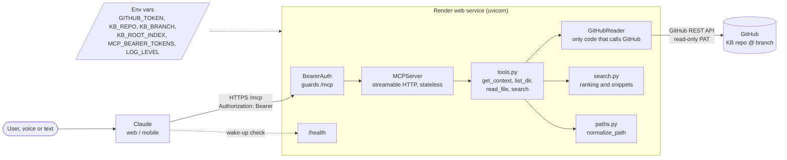
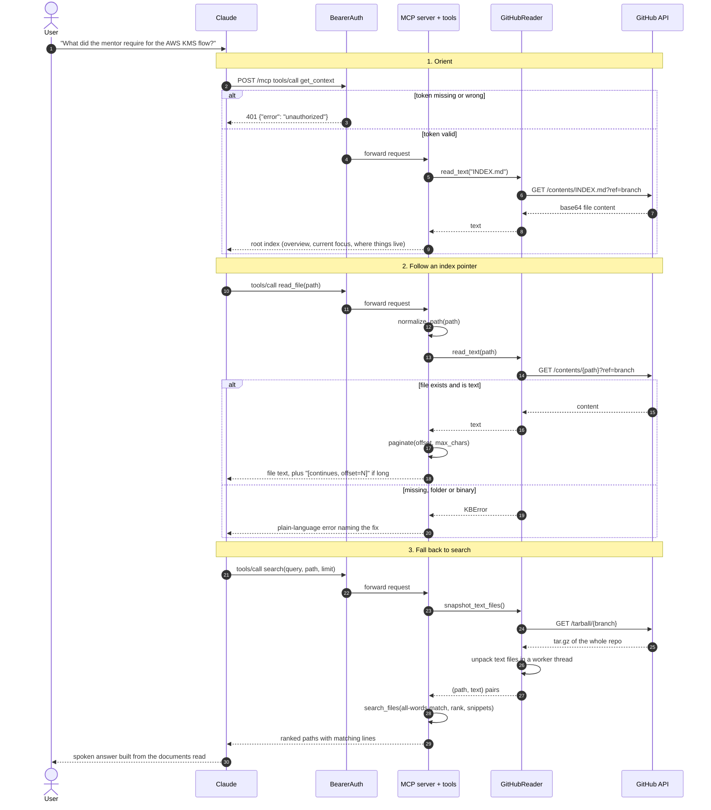

# KB MCP Server: Software Design Document

Date: 2026-10-15
Status: describes the implemented v1

## 1. Overview

### What it is

A read-only remote MCP server that gives Claude (claude.ai web, mobile and voice mode) live access to one GitHub-hosted project knowledge base (KB). Today the KB is the OpenKCM project's working memory: meeting transcripts, architecture decisions, findings, proposed designs and mentor requirements.

### Why it exists

Talk to Claude by voice and have it already understand the project's context and current focus. It should be able to research a specific flow (e.g. the AWS KMS integration), recall what the mentor required, and walk through proposed architectures, without the user pasting documents into the chat.

### Goals

- Always-fresh answers: every tool call reads GitHub, nothing is cached or stored.
- Few, explicit tools with short plain-text output, because conversations are often spoken.
- Minimal footprint: one KB repo and branch, fixed by environment variables.

### Non-goals

- No write path. Only GET requests to GitHub, no write tools.
- No parsing of index files. A separate skill maintains `INDEX.md` files and Claude reads them itself.
- No external documentation lookup. Claude's own web search covers that.

### Users

| User | Access |
|---|---|
| Repo owner (primary) | Claude connector with a bearer token |
| Mentor (stretch) | Own token added to `MCP_BEARER_TOKENS` |

### Tools

| Tool | Purpose |
|---|---|
| `get_context()` | Root index: project overview, current focus, where things live. Claude calls it first. |
| `list_dir(path="")` | Direct children of a folder. |
| `read_file(path, offset=0, max_chars=15000)` | File text, paginated (at most 50 000 chars per call). |
| `search(query, path="", limit=10)` | All-words match over file names and text, ranked, with snippets. |

## 2. Architecture

### Components

| Module | Responsibility |
|---|---|
| `app.py` | Wires settings, reader, server, tools, `/health` and auth into the ASGI `app`. Runs a non-fatal GitHub startup check in the background. |
| `config.py` | Reads env vars into `Settings`; fails fast on bad config. |
| `logging_setup.py` | One log format on stdout, `LOG_LEVEL`, uvicorn logs routed through it, `/health` access lines filtered out. |
| `auth.py` | `BearerAuth` ASGI middleware for `/mcp`. Constant-time token comparison, accepts `Bearer <token>` or a bare token. Logs why a request was rejected. |
| `errors.py` | `KBError` hierarchy. Messages of anticipated failures reach Claude. |
| `paths.py` | `normalize_path`, the only path sanitizer. Rejects paths that climb above the KB root. |
| `github_reader.py` | `read_text`, `get_tree`, `list_dir`, `snapshot_text_files`. The only code that talks to GitHub. |
| `search.py` | Pure ranking and snippet functions over `(path, text)` pairs. |
| `tools.py` | The four MCP tools, pagination and voice-friendly formatting. |

### GitHub API used per tool

| Tool | GitHub call |
|---|---|
| `get_context`, `read_file` | Contents API (`/contents/{path}?ref=branch`) |
| `list_dir` | Git trees API (`/git/trees/{branch}?recursive=1`) |
| `search` | Tarball download (`/tarball/{branch}`), unpacked in memory. GitHub's code-search API is not used because its index lags behind pushes. |

### Deployment

Render free web service from `render.yaml`, deployed from git. A `Dockerfile` and GitHub Actions (CI on pull requests, CD publishing the image to Docker Hub from `main` and `v*` tags) provide a separate container artifact. The Render free tier sleeps after about 15 minutes idle, so `/health` is opened before a voice session. `/health` never calls GitHub.

## 3. Flow

A typical voice session: Claude orients itself, follows an index pointer, then falls back to search.

### Error handling

| Situation | Result |
|---|---|
| Missing or invalid token | `401` JSON, deliberately without `WWW-Authenticate` so Claude's connector dialog doesn't start OAuth. |
| File or folder not found, wrong type, binary file, empty search | `KBError` subclass; its message is shown to Claude with a hint (use `list_dir` or `search`). |
| GitHub unreachable, rate-limited or refusing the token | `KBUnavailableError` with a retry or config hint. |
| Any other exception | Claude sees only "Error executing tool". |

### Observability

Logs go to stdout (Render Logs tab, `docker logs`). `LOG_LEVEL` defaults to `INFO`.

| Source | What is logged |
|---|---|
| Startup | Version, commit, repo, branch, root index, token count, then the result of the GitHub startup check. The check runs in the background and never blocks `/health`, so a bad token is logged, not fatal. |
| Each tool call | Tool name, clipped arguments, outcome (`ok`, the `KBError` class, or a crash), duration and result size. |
| Each GitHub request | URL path, status, duration, remaining rate limit; a warning when fewer than 100 requests are left; a status-specific hint on 401, 403 and 429. |
| Rejected `/mcp` requests | Reason, client address and user agent. Token length is logged, never the token. |

Tokens, file contents and GitHub redirect URLs are never logged.

## 4. Key decisions

| Topic | Decision | Reason |
|---|---|---|
| Access | Read-only | Smallest blast radius; the GitHub PAT has `Contents: read` only. |
| Freshness | Live reads, no cache | The KB changes between sessions; a cache needs invalidation. `GitHubReader` is the single seam where one can be added later. |
| Index coupling | Thin file tools plus `get_context` | The server never parses indexes, so the KB layout can evolve without code changes. |
| Transport | Streamable HTTP, stateless, JSON responses | No session state to lose when the free tier restarts. |
| Auth | Static bearer tokens in a connector request header | Simple, supports several tokens (mentor), constant-time compare. |
| Search | Tarball download, not GitHub code search | Always reflects the latest push. |

## 5. Future improvements

- Uptime pinger on `/health`.
- Cached mode keyed on the commit SHA, plus a `refresh` tool.
- Mentor access through an extra token in `MCP_BEARER_TOKENS`.
- `get_focus_bundle(topic)`.
- A write path, which would need its own design.
